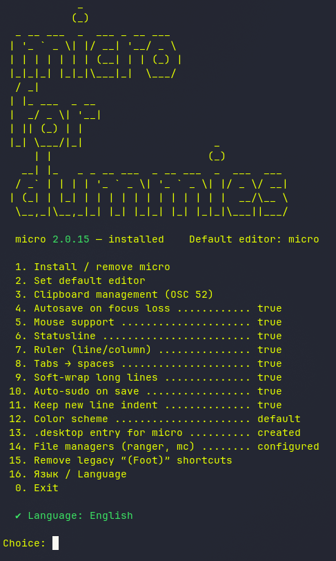

# micro-for-dummies



Interactive script to install and configure the [micro](https://micro-editor.github.io/) text editor.

## Menu

1. Install / remove micro
2. Set default editor (bash + fish)
3. Clipboard management (OSC 52 — copy/paste between your PC and a remote VPS)
4. Autosave on focus loss
5. Mouse support
6. Statusline
7. Ruler (line/column)
8. Tabs → spaces
9. Soft-wrap long lines
10. Auto-sudo on save
11. Keep new line indent
12. Color scheme
13. `.desktop` entry for micro (fixes “Unable to find terminal” on Sway)
14. File managers (ranger, mc, vifm)
15. Remove legacy “(Foot)” shortcuts
16. Язык / Language — switch UI language
0. Exit

## Usage

```bash
curl -O https://raw.githubusercontent.com/vrzdrb/micro-for-dummies/main/micro-for-dummies.sh
chmod +x micro-for-dummies.sh
./micro-for-dummies.sh
```
