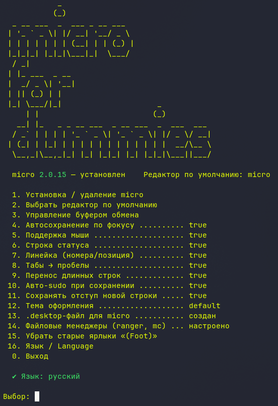

# micro-for-dummies

**🇬🇧 [English](README.md)**



Интерактивный скрипт для установки и настройки текстового редактора [micro](https://micro-editor.github.io/).

## Меню

1. Установка / удаление micro
2. Выбрать редактор по умолчанию (bash + fish)
3. Управление буфером обмена (OSC 52 — копипаст между ПК и удалённым VPS)
4. Автосохранение по фокусу
5. Поддержка мыши
6. Строка статуса
7. Линейка (номера/позиция)
8. Табы → пробелы
9. Перенос длинных строк
10. Авто-sudo при сохранении
11. Сохранять отступ новой строки
12. Тема оформления
13. `.desktop`-файл для micro (чинит «Не удалось найти терминал» в Sway)
14. Файловые менеджеры (ranger, mc, vifm)
15. Убрать старые ярлыки «(Foot)»
16. Язык / Language — переключение языка интерфейса
0. Выход

## Запуск

```bash
curl -O https://raw.githubusercontent.com/vrzdrb/micro-for-dummies/main/micro-for-dummies.sh
chmod +x micro-for-dummies.sh
./micro-for-dummies.sh
```
